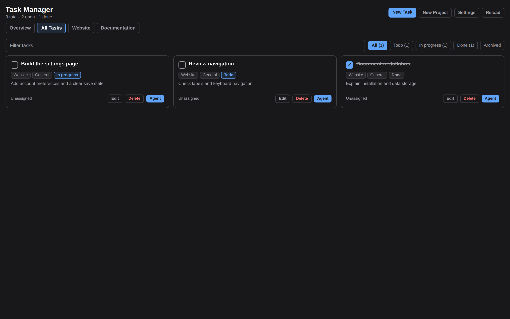
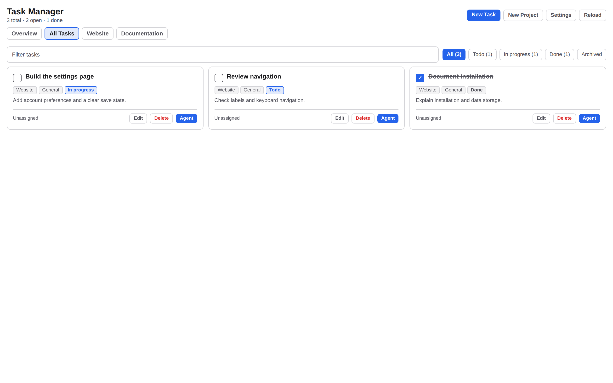
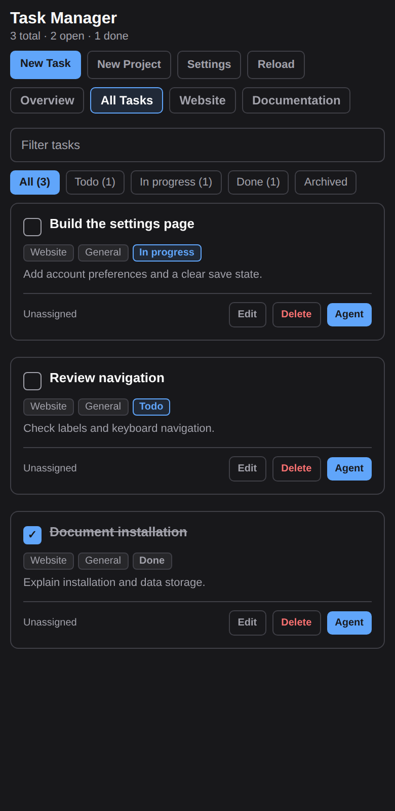
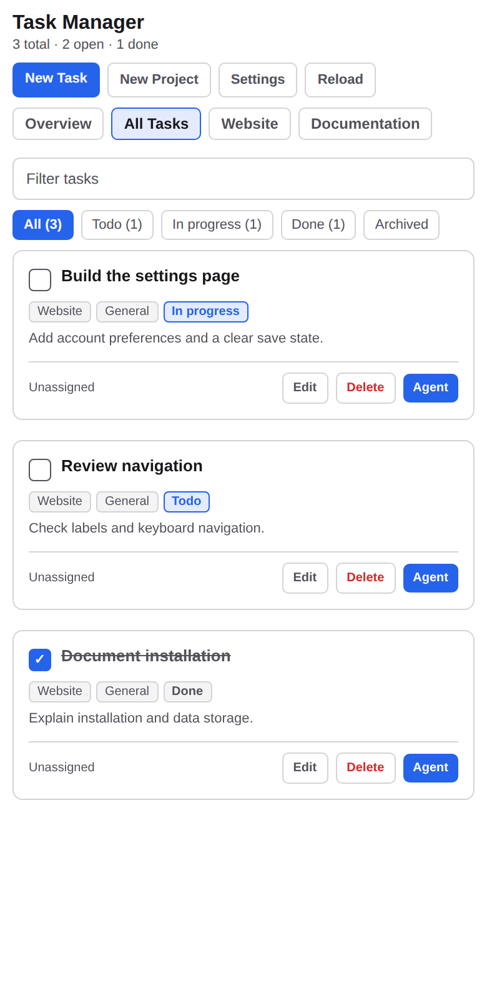
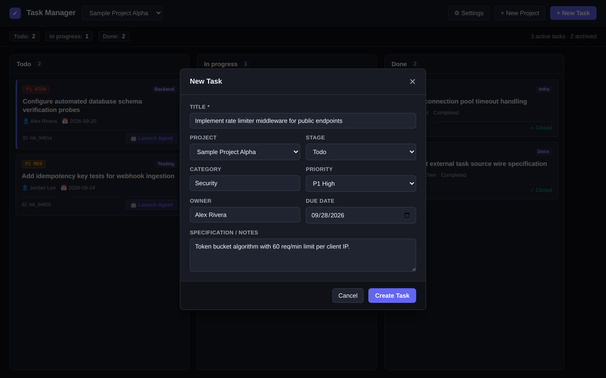
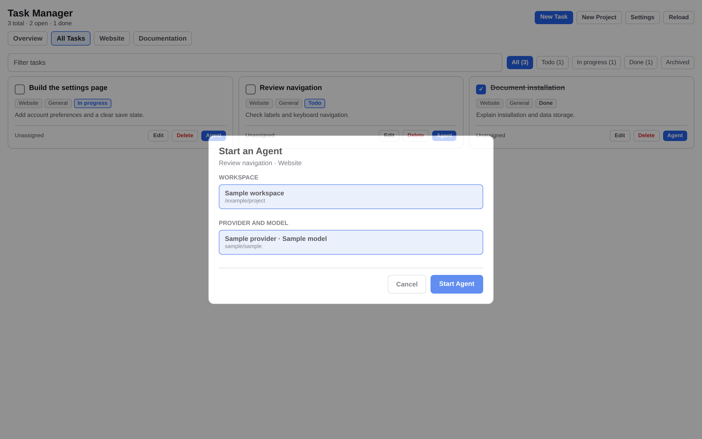

# Task Manager

A Paseo plugin for keeping projects and tasks, moving tasks through your own stages, and starting a coding agent on a task when you choose to. The plugin ID is `paseo-task-manager`.


## Screenshots

These pictures show the real plugin with sample data in a local preview. The preview can't start agents, and it isn't anyone's real Paseo session.

| View | Dark | Light |
|:--|:--|:--|
| Task cards |  |  |
| Compact |  |  |
| Dialogs |  |  |

## Requirements

- Paseo 0.15.0 or later, on both the daemon and the app.
- Node.js 24 or later, only if you work on the code or make screenshots.

## Install

From a copy of this repository:

```bash
npm ci
npm run check
paseo plugin install . --id paseo-task-manager
paseo plugin ls
```

Paseo plugins run without a sandbox, so only install code you trust.

## Get started

1. Click **New Project** and give it a name. A new install starts empty.
2. Click **New Task**, pick a project, and type a title. You can also set a category, stage, priority, owner, due date, details, notes, and a link.
3. Use the project tabs, stage buttons, and search box to find tasks. **Overview** shows totals and lets you rename or delete projects.

New boards start with three stages: `Todo`, `In progress`, and `Done`. You can rename and reorder them in **Settings**. The last stage always means "done." If you remove a stage, its tasks move to the closest stage that is left.

Deleting a project also deletes its tasks. The plugin asks you to confirm first.

## Start an agent on a task

Click **Agent** on a task card. Pick a workspace and a provider and model, then read the prompt. Nothing starts until you click **Launch Agent**. The plugin never picks a workspace or provider for you, and never starts agents on its own.

## Where your data lives

- Tasks are saved on the daemon's computer in `~/.paseo/plugin-data/paseo-task-manager/board.json`. Settings are in `preferences.json` and `source.json` in the same folder.
- `PASEO_HOME` changes the Paseo folder. `PASEO_TASK_MANAGER_DATA_DIR` changes the plugin's data folder directly.
- On macOS and Linux, only your user can read the folder and its files.
- The plugin talks only to your own Paseo daemon, to list workspaces, providers, and agents.
- You can add an outside task source. The plugin only reads from it, when the board loads or you click **Reload**. If it fails, your local tasks still show, with a warning. See [the external source format](docs/external-source.md).

## Update or remove

After you pull new code:

```bash
npm ci
npm run check
paseo plugin reload paseo-task-manager
```

Reloading keeps your tasks. To remove the plugin:

```bash
paseo plugin remove paseo-task-manager
```

Your data folder stays behind. Back it up before you delete it.

## If the board is damaged

If `board.json` can't be read, the plugin renames it to `board.corrupt-<time>-<id>.json` and starts an empty board. It never writes over a file it couldn't read. To get your tasks back, fix the JSON in the saved copy and rename it to `board.json`.

If the plugin won't load:

```bash
paseo plugin logs paseo-task-manager
npm run typecheck
```

## Work on the code

```bash
npm run check                         # typecheck and tests
npm run verify                        # package, docs, and secret checks
node scripts/generate-screenshots.js  # rebuild the screenshots
```

`npm run verify` looks for common mistakes, like a missing changelog entry or a leaked path. It can't prove nothing private is left, so look over files and images yourself before you publish.

To prepare a release on your own computer (no Git changes):

```bash
RELEASE_NOTES='Describe the user-visible changes.' node scripts/prepare-release.mjs patch
```

The **Release PR** workflow on GitHub does the same thing in a pull request. It runs as a dry run unless you turn that off, and it never publishes anything.

## License and support

[MIT License](LICENSE). Report bugs or ideas with the [issue templates](.github/ISSUE_TEMPLATE). See [SECURITY.md](SECURITY.md) to report a security problem.
